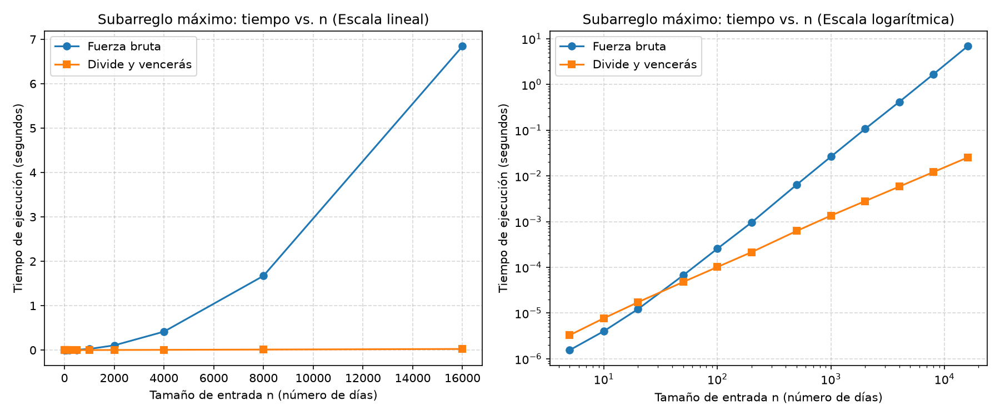

# Laboratorio evaluativo 02: Dividir y vencer

**Autor:** Miguel Angel Arango Puerta (miguelarangop36@gmail.com)

## Cómo reproducir el experimento

Desde la raíz del repositorio (`curso-analisis-algoritmos/`), activar el entorno:

```bash
# Windows (PowerShell)
.\venv\Scripts\Activate.ps1

# Mac / Linux
source venv/bin/activate
```

Y después:

```bash
pip install -r requirements.txt
cd laboratorios/lab2-divide-y-vencer
python pruebas.py     # verifica las dos soluciones
python medicion.py    # mide, imprime los tiempos y guarda la gráfica (tarda cerca de un minuto)
```

---

## Parte 1. Implementar y verificar las dos soluciones

Código: [subarreglo.py](subarreglo.py) (las tres funciones) y [pruebas.py](pruebas.py) (los `assert`).

Las pruebas cubren:

- La serie de ocho días de la cooperativa, que da 17 con las dos funciones.
- Series de un solo elemento (`[7]`, `[-7]` y `[0]`).
- Todos negativos (gana el menos malo, `-2`) y todos positivos (gana la serie completa, 26).
- Un caso donde el mejor tramo cruza el punto medio (`[1, -1, 10, 10, -1, 1]`, suma 20), y `suma_cruzada` probada sola.
- 25 listas aleatorias (semilla 2026, tamaños de 1 a 200) donde las dos funciones tienen que dar la misma suma. Además compruebo que el tramo que devuelven de verdad suma lo que dicen, y que la lista de entrada no cambia.

Comparo sumas y no índices, porque si hay empate cualquier tramo vale. También probé a romper `suma_cruzada` a propósito para ver que los `assert` fallan, y fallan.

---

## Parte 2. Medir y graficar

Código: [medicion.py](medicion.py).



Cómo medí: listas de enteros entre -100 y 100 con semilla 42, la misma lista para los dos algoritmos en cada tamaño, y solo cronometré la llamada con `time.perf_counter()`, no la generación. Cada tiempo es la mediana de 3 repeticiones. En los tamaños chicos una llamada dura microsegundos y el reloj casi no la distingue, así que agrupé varias llamadas (500 hasta n = 100, 20 hasta n = 1000) y dividí. El experimento también comprueba con un `assert` que las dos sumas coinciden en cada tamaño. Hice la gráfica en escala lineal y logarítmica en el mismo PNG, porque en la lineal la de divide y vencerás queda pegada al eje.

| n | Fuerza bruta (ms) | Divide y vencerás (ms) |
|---|---|---|
| 5 | 0,0016 | 0,0033 |
| 10 | 0,0040 | 0,0077 |
| 20 | 0,0123 | 0,0173 |
| 50 | 0,0670 | 0,0479 |
| 100 | 0,256 | 0,102 |
| 200 | 0,959 | 0,215 |
| 500 | 6,43 | 0,626 |
| 1000 | 26,3 | 1,35 |
| 2000 | 107 | 2,81 |
| 4000 | 416 | 5,84 |
| 8000 | 1672 | 12,1 |
| 16000 | 6843 | 25,2 |

---

## Parte 3. Análisis

**1. Recurrencia.** En `subarreglo_maximo` cada llamada la parto en dos mitades (`inicio..medio` y `medio+1..fin`), o sea 2 subproblemas de tamaño n/2. El caso cruzado hace un barrido a la izquierda y otro a la derecha, y entre los dos recorren el rango una sola vez: Θ(n). Elegir el mejor de los tres es solo comparar tres sumas, Θ(1). Entonces queda `T(n) = 2T(n/2) + Θ(n)`. Aplicando el método maestro (donde a = 2, b = 2 y f(n) = n), tenemos que n^(log₂2) = n. Como f(n) crece igual que esta potencia (que es justo la condición del caso 2), nos da que `T(n) = Θ(n log n)`. Por otro lado, la fuerza bruta es Θ(n²) porque para cada inicio i el ciclo interno hace n − i pasos de costo constante (la suma se va acumulando), y la suma de n + (n−1) + … + 1 = n(n+1)/2.

**2. Lo medido contra lo esperado.** En la gráfica lineal se ve que la fuerza bruta se dispara como una parábola: 0,42 s en n = 4000; 1,67 s en 8000 y 6,84 s en 16000. Divide y vencerás casi ni se despega del eje (5,8 ms, 12,1 ms y 25,2 ms). Si duplicamos n de 8000 a 16000, la fuerza bruta se multiplicó por 6,843 / 1,672 ≈ 4,09 y divide y vencerás por 25,24 / 12,14 ≈ 2,08. Esto cuadra con la teoría: Θ(n²) predice 4 (porque (2n)² / n² = 4) y Θ(n log n) predice 2 · log₂(16000) / log₂(8000) ≈ 2,15. En la escala logarítmica se ve igual: una recta con pendiente cercana a 2 y otra cercana a 1.

**3. Tamaños pequeños.** Acá sí hay cruce y se nota. En n = 20 la fuerza bruta todavía gana (0,0123 ms contra 0,0173 ms), pero en n = 50 ya pasa a ganar divide y vencerás (0,0479 contra 0,0670). Después la ventaja crece rápido: 2,5 veces en n = 100 y unas 19 veces en n = 1000. Esta ventaja aparece pronto pero al principio es poca, porque con un n chiquito, n² todavía es un número pequeño y divide y vencerás paga el costo extra de las llamadas recursivas, las tuplas y dos barridos por nivel. Esas constantes iniciales pesan más que lo que uno se ahorra dividiendo.

**4. ¿Cuándo conviene dividir?** Para sacar el máximo de un arreglo normal no aguanta, no hay mejora. Partirlo en dos, sacar el máximo de cada mitad y compararlos da `T(n) = 2T(n/2) + Θ(1)`, porque combinar es una sola comparación. Por el método maestro, n^(log₂2) = n y f(n) = Θ(1) es polinomialmente menor (caso 1), así que `T(n) = Θ(n)`. O sea, cuesta lo mismo que recorrerlo una vez, más el peso de las llamadas recursivas. En el problema del subarreglo sí sirve porque la fuerza bruta es Θ(n²) y dividirlo lo baja a Θ(n log n) pagando un costo de combinación de Θ(n). En resumen, conviene dividir solo cuando la solución directa sale más cara que el proceso de partir y combinar.

**5. Recomendación para gerencia.** Recomiendo usar divide y vencerás para la cooperativa. Es una estimación, no la medí directamente: tomo el mayor tamaño que medí, n = 16000, y lo paso a 1.000.000, que es 62,5 veces más. Como la fuerza bruta es cuadrática, el tiempo se multiplica por 62,5² ≈ 3.906. Esto nos daría 6,84 s × 3.906 ≈ 26.700 s (unas 7,4 horas). En cambio, divide y vencerás es n log n, entonces se multiplica por 62,5 × log₂(10⁶) / log₂(16000) ≈ 89, lo que da 0,0252 s × 89 ≈ 2,3 s. (No usé regla de tres lineal porque ninguno de los dos crece lineal.) Estos cálculos asumen que usamos la misma máquina y que la memoria a esa escala no cambie las constantes. Para el análisis de las tiendas (2.000 días) cualquiera de los dos sirve: la fuerza bruta tardaría unos 3 minutos en las 1.500 tiendas y divide y vencerás unos 4 segundos. Pero para procesar las series de sensores, la única opción viable es divide y vencerás.
