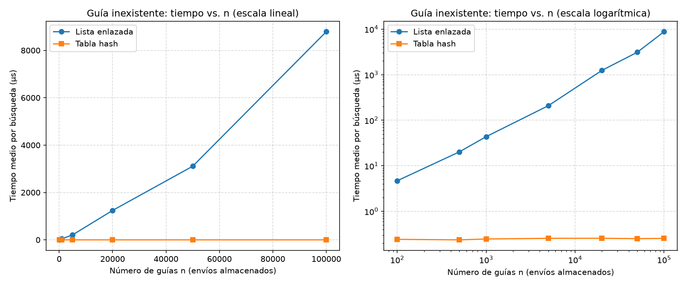
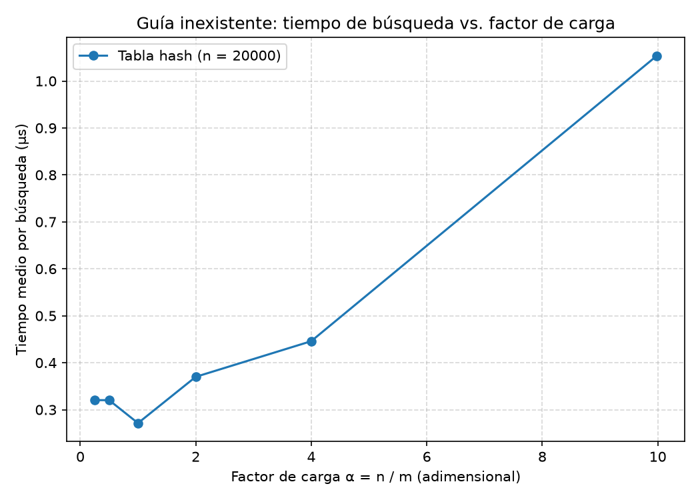

# Laboratorio evaluativo 03: Estructuras de datos

**Autor:** Miguel Angel Arango Puerta (miguelarangop36@gmail.com)

## Cómo reproducir el experimento

Desde la raíz del repositorio (`curso-analisis-algoritmos/`), activar el entorno:

```bash
# Windows (PowerShell)
.\venv\Scripts\Activate.ps1

# Mac / Linux
source venv/bin/activate
```

Y después:

```bash
pip install -r requirements.txt
cd laboratorios/lab3-estructuras-datos
python pruebas.py     # verifica las dos estructuras
python medicion.py    # mide, imprime los datos y guarda las dos gráficas (tarda menos de un minuto)
```

---

## Parte 1. Implementar y verificar las dos estructuras

Código: [estructuras.py](estructuras.py) (`Nodo`, `ListaEnlazada` y `TablaHash`) y [pruebas.py](pruebas.py) (los `assert`).

Las pruebas cubren:

- La serie de ejemplo de la situación problema (cuatro guías), con búsqueda exitosa y búsqueda de una guía que no existe en la lista y en la tabla.
- Estructuras vacías (buscar devuelve `None`) y que la lista inserta al inicio y lleva bien su tamaño.
- La colisión forzada con m = 7: las guías 10, 24 y 17 caen en la casilla 3, las tres se insertan y se encuentran después, y la lista de esa casilla tiene longitud 3 (las otras seis casillas quedan vacías).
- `factor_carga()` da 3/7 después de esas tres inserciones, y con m = 1 las 50 guías caen en la misma casilla.
- 25 colecciones aleatorias (hasta 300 guías, m entre 1 y 60, semilla 2026) donde lista y tabla tienen que dar el mismo estado para todas las guías que existen y para 30 que no existen.

En las pruebas uso un diccionario solo como referencia para saber qué estado esperar, las estructuras no lo usan. También rompí la tabla a propósito de dos formas (una función hash equivocada y una tabla que inventa respuestas) para ver que los `assert` fallan, y fallan.

---

## Parte 2. Medir y graficar

Código: [medicion.py](medicion.py).





Cómo medí: guías de diez dígitos distintas con semilla 42, las mismas para la lista y la tabla en cada n, y solo cronometré las búsquedas con `time.perf_counter()`, no la construcción ni la generación. Todas las búsquedas son de guías que no existen (las genera la función `generar_guias_inexistentes` de la guía). En el experimento A son 200 búsquedas por n y en el B son 5.000. Cada tiempo es la mediana de 5 repeticiones del promedio por búsqueda. En cada estructura construida, el experimento también comprueba con un `assert` que lista y tabla dan el mismo estado en una muestra de 100 guías que sí existen. En el A usé m = el primer primo mayor o igual a n / 2, así que α queda en 2.

Experimento A (tiempo medio por búsqueda, en microsegundos):

| n | m | α | Lista (µs) | Tabla (µs) |
|---|---|---|---|---|
| 100 | 53 | 1,89 | 4,70 | 0,243 |
| 500 | 251 | 1,99 | 20,2 | 0,237 |
| 1.000 | 503 | 1,99 | 43,6 | 0,247 |
| 5.000 | 2.503 | 2,00 | 209 | 0,256 |
| 20.000 | 10.007 | 2,00 | 1.242 | 0,256 |
| 50.000 | 25.013 | 2,00 | 3.109 | 0,252 |
| 100.000 | 50.021 | 2,00 | 8.789 | 0,255 |

Experimento B (n = 20.000, tabla hash):

| m | α | Tabla (µs) |
|---|---|---|
| 80.021 | 0,25 | 0,320 |
| 40.009 | 0,50 | 0,320 |
| 20.011 | 1,00 | 0,271 |
| 10.007 | 2,00 | 0,370 |
| 5.003 | 4,00 | 0,446 |
| 2.003 | 9,99 | 1,054 |

---

## Parte 3. Análisis

**1. Costo teórico.** Si la guía no existe, la lista tiene que compararla con cada nodo hasta llegar al final, o sea n comparaciones: Θ(n). En la tabla se calcula la casilla con k mod m (Θ(1)) y se recorre solo la lista de esa casilla, entera porque la guía no existe. Si la función hash reparte parejo, cada lista mide en promedio n / m = α. Entonces el costo es 1 + α: Θ(1 + α). El supuesto es el hash uniforme simple: cada guía tiene la misma probabilidad de caer en cualquiera de las m casillas, sin importar dónde cayeron las demás. Si todas cayeran en la misma casilla, la tabla tendría una sola lista de n nodos y buscar volvería a ser Θ(n), o sea una lista enlazada normal.

**2. Lo medido contra lo esperado.** De n = 500 a n = 1.000 (n se duplica) la lista pasó de 20,2 a 43,6 µs, un factor de 2,16, y la tabla de 0,237 a 0,247, un factor de 1,04. De n = 1.000 a 5.000 (n × 5) la lista se multiplicó por 4,78 y la tabla por 1,03. Eso coincide con Θ(n) para la lista y con Θ(1) para la tabla, que se queda en unos 0,25 µs en todo el rango. Pero la lista se pasa un poco del factor de n más adelante: de 5.000 a 20.000 (n × 4) se multiplicó por 5,95 y de 50.000 a 100.000 (n × 2) por 2,83. El tiempo por nodo pasó de unos 42 ns con n = 5.000 a unos 88 ns con n = 100.000. Mi hipótesis es que la lista ya no cabe en la caché del procesador, pero no la comprobé. En la segunda gráfica, con α ≤ 1 el tiempo es casi plano (0,27 a 0,32 µs, y las diferencias son ruido, de hecho α = 1 sale más bajo que α = 0,25), porque ahí manda el costo fijo de calcular el hash y llamar al método. Desde α = 2 sube: 0,37; 0,45 y 1,05 µs. De α = 4 a α = 10 el tiempo se multiplicó por 2,36 y Θ(1 + α) predice (1 + 10) / (1 + 4) = 2,2. Es coherente.

**3. Colisiones.** Una colisión es cuando dos claves distintas caen en la misma casilla. Pasa aunque haya más casillas que guías, porque las guías son números de diez dígitos (miles de millones de posibles) y se reparten en m casillas, y con n guías basta que dos coincidan. En el ejemplo, con m = 7: 10 mod 7, 24 mod 7 y 17 mod 7 dan 3, así que las tres guías compiten por la casilla 3. El encadenamiento guarda en cada casilla una lista con todas las que caen ahí. Su ventaja es que es simple y aguanta α mayor que 1; su costo es memoria extra por los nodos y punteros, y menos localidad en memoria. El direccionamiento abierto guarda todo dentro del propio arreglo y, si la casilla está ocupada, prueba otras casillas siguiendo una secuencia. Su ventaja es que no usa punteros y aprovecha mejor la caché; sus costos son que α no puede pasar de 1, que se degrada muy rápido cuando se llena, y que borrar es más complicado.

**4. Tabla hash o árbol de búsqueda.** Para "guías entre X y Y" la tabla hash no sirve, porque k mod m reparte las guías sin ningún orden y las de un rango quedan regadas por todas las casillas. Habría que revisar las n guías (y las m casillas) para ver cuáles caen en el rango. Un árbol de búsqueda binario sí sirve: se busca X en O(altura) y se recorre en orden hasta pasar Y, o sea O(h + k) con k las guías del rango. Si las 400.000 guías llegaran ordenadas y se insertaran una a una, cada guía nueva es la mayor y se va al hijo derecho, así que el árbol queda como una lista: altura de unos 400.000 niveles y unas 400.000 comparaciones para una guía inexistente. Un árbol equilibrado tendría altura de unos log₂(400.000) ≈ 18,6, o sea unas 19 comparaciones, más de 20.000 veces menos.

**5. Concepto para la jefa de operaciones.** Recomiendo una combinación: tabla hash para la consulta del call center y un árbol de búsqueda equilibrado para el monitoreo por rango. Cuesta el doble de memoria y mantener las dos al día en cada inserción. Estimación para 5.000.000 de envíos, buscando una guía inexistente: la lista es Θ(n) (el factor de n fue cercano a n entre 500 y 5.000), así que desde los 8.789 µs de n = 100.000 el tiempo se multiplica por 50: unos 440.000 µs, o sea unos 0,44 s, y probablemente más porque el tiempo por nodo viene subiendo. La tabla, creciendo m para dejar α en 2, se queda plana en mi gráfica: unos 0,25 µs, aunque con tanta memoria podría llegar a 1 µs. Eso es entre 440.000 y 1,7 millones de veces menos, según sea 1 µs o 0,25 µs. Si en cambio dejaran m fijo, α subiría a unos 100 y según la pendiente de mi segunda gráfica serían unos 10 µs.
